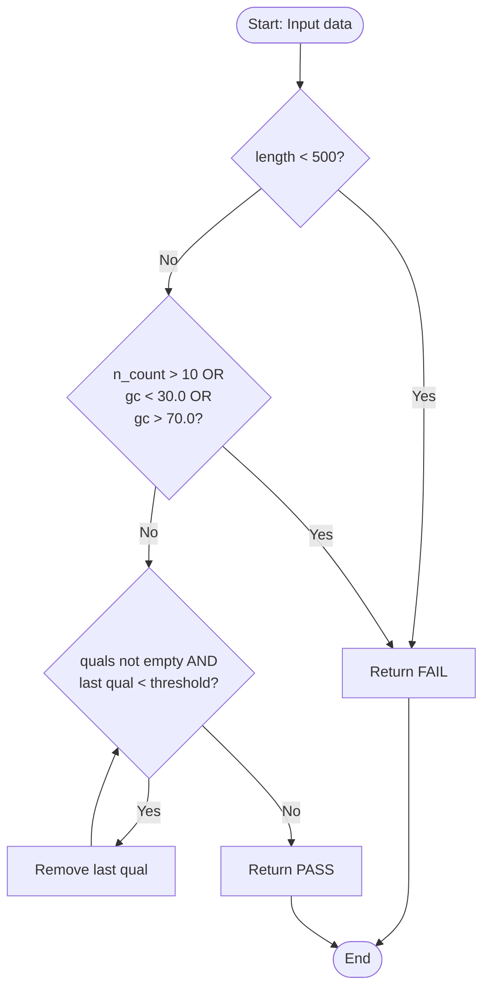

# design/qc_design.md (skeleton)
## Problem
The quality control algorithm process on biological sequence

- **Input:** 
  - `classify_read`: Takes three numeric values—`length` (int), `n_count` (int), and `gc` (float). 
  - `trim_low_quality`: Takes a list of numeric quality scores `quals` and a `threshold` (default 20).
- **Output:** 
  - `classify_read`: Returns a decision string ("PASS" or "FAIL").
  - `trim_low_quality`: Returns the trimmed list of quality scores.
- **Constraints & Boundaries:** 
  - Sequence length must be 500 or greater (>= 500).
  - Number of 'N' bases must be 10 or fewer (<= 10).
  - GC percentage must be within 30.0 to 70.0 (inclusive limit).

## Pseudocode
```text
CONSTANTS:
    MIN_LEN = 500
    MAX_N = 10
    GC_LOW = 30.0
    GC_HIGH = 70.0
    QUAL_THRESHOLD = 20

FUNCTION process_record(length, n_count, gc, quals):
    IF length < MIN_LEN:
        RETURN "FAIL"
    
    IF n_count > MAX_N OR gc < GC_LOW OR gc > GC_HIGH:
        RETURN "FAIL"
    
    WHILE length of quals > 0 AND last element of quals < QUAL_THRESHOLD:
        REMOVE last element from quals
    END WHILE
    
    RETURN "PASS"
```

## Flowchart


## Trace

| sample | length | n_count | gc | length < 500? | N > 10 or GC outside 30-70? | decision |
|---|---|---|---|---|---|---|
| R03 | 420 | 0 | 68.5 | True | False | FAIL |
| R04 | 500 | 10 | 45.0 | False | False | PASS |
| R05 | 640 | 3 | 72.4 | False | True | FAIL |
| R07 | 499 | 0 | 50.0 | True | False | FAIL |