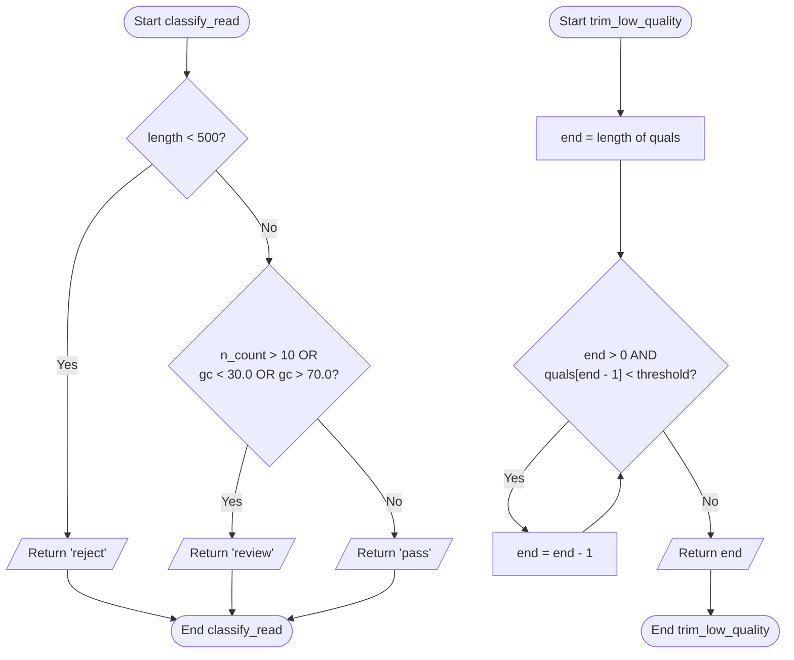

# design/qc_design.md (skeleton)

## Problem
The quality control algorithm process on biological sequence

- **Input:** 
  - `classify_read`: Takes three numeric values—`length` (int), `n_count` (int), and `gc` (float). 
  - `trim_low_quality`: Takes a list of numeric quality scores `quals` and a `threshold` (default 20).
- **Output:** 
  - `classify_read`: Returns a decision string ('reject', 'review', or 'pass').
  - `trim_low_quality`: Returns the index where the low-quality tail starts (which is the number of bases to keep).
- **Constraints & Boundaries:** 
  - Sequence length must be 500 or greater to pass.
  - Number of 'N' bases must be 10 or fewer to pass.
  - GC percentage must be within 30.0 to 70.0 (inclusive limit) to pass.

## Pseudocode
```text
Function classify_read(length, n_count, gc):
    If length < 500:
        Return 'reject'
    Else if n_count > 10 OR gc < 30.0 OR gc > 70.0:
        Return 'review'
    Else:
        Return 'pass'

Function trim_low_quality(quals, threshold):
    Set end = length of quals
    While end > 0 AND quals[end - 1] < threshold:
        end = end - 1
    Return end
```

## Flowchart


## Trace

| sample | length | n_count | gc | length < 500? | N > 10 or GC outside 30-70? | decision |
|---|---|---|---|---|---|---|
| R03 | 420 | 0 | 68.5 | True | False | Reject |
| R04 | 500 | 10 | 45.0 | False | False | PASS |
| R05 | 640 | 3 | 72.4 | False | True | Review |
| R07 | 499 | 0 | 50.0 | True | False | Reject |